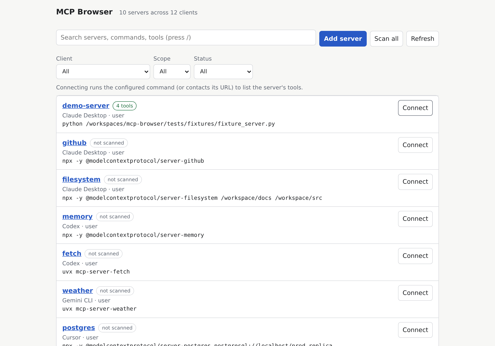
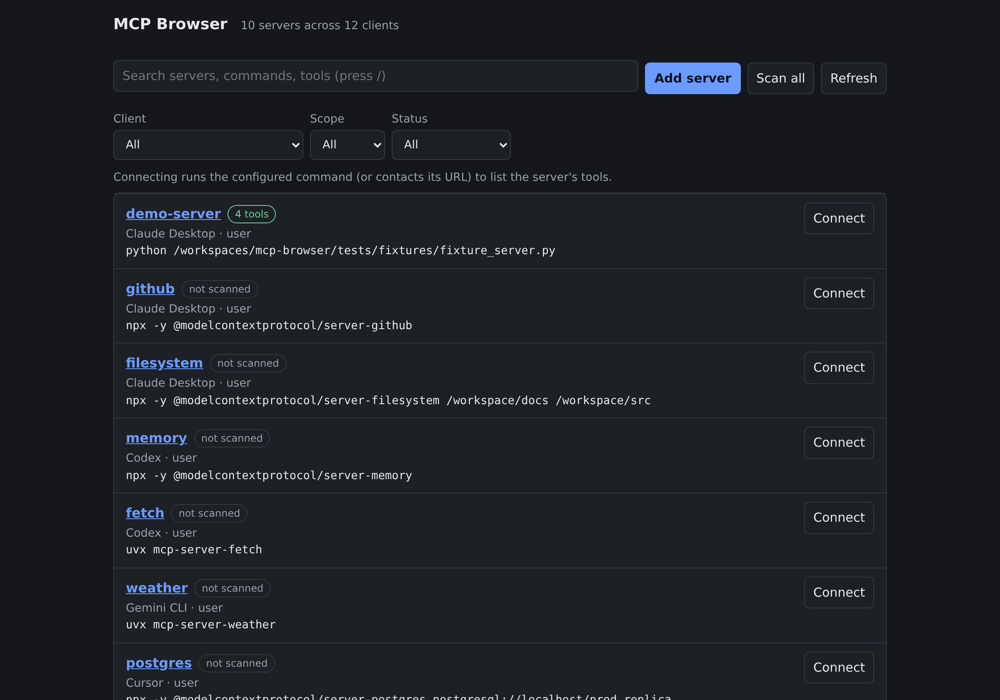
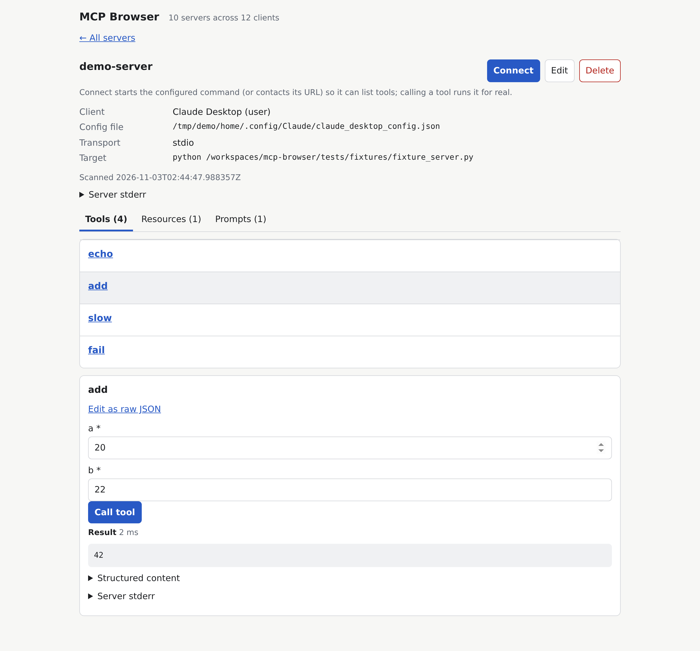
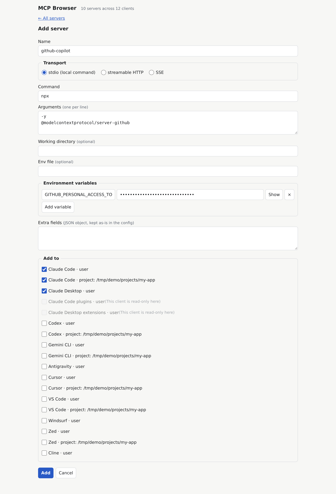

# MCP Browser

[](https://mcpbrowser.weydson.com)
[](https://github.com/raisen/mcp-browser/releases)
[](https://github.com/raisen/mcp-browser/actions/workflows/ci.yml)
[](https://github.com/raisen/mcp-browser/blob/main/LICENSE)
[](https://www.python.org/)

A local web dashboard and native macOS app to browse, search, test, and safely configure Model Context Protocol (MCP) servers across all your AI coding assistants (Claude Code, Claude Desktop, Cursor, VS Code, Windsurf, Zed, Cline, Codex, Gemini CLI, Antigravity).



- **See everything in one place.** Claude Code, Claude Desktop, Codex, Gemini CLI, Antigravity, Cursor,
  VS Code, Windsurf, Zed and Cline, plus Claude Code plugins and Claude Desktop extensions (read-only).
- **Connect and try.** Start a server, list its tools, resources and prompts, fill a form generated from the
  tool's JSON Schema and call it, all from the browser.
- **Edit without hand-editing JSON/TOML.** Add one server to several clients at once, change or delete it,
  with a backup of every file before it is touched.
- **Local only.** It listens on `127.0.0.1`, needs a token, and sends nothing anywhere.

## Screenshots

| Server list (light) | Server list (dark) |
| --- | --- |
|  |  |

| Server detail & tool execution | Add server to multiple clients |
| --- | --- |
|  |  |

## Quick start

Python 3.11 or newer is required for terminal installation with `uv` or `pip`. The native macOS `.dmg` and standalone zips need nothing.

### macOS Native App (.dmg)

Download the disk image from the [Releases](https://github.com/raisen/mcp-browser/releases) page (`mcp-browser-X.Y.Z-macos-arm64.dmg` for Apple Silicon or `mcp-browser-X.Y.Z-macos-x86_64.dmg` for Intel). Open the `.dmg`, drag `MCP Browser.app` to `/Applications`, and run it.

- **Menu Bar Controls:** Status bar icon showing server state (Running on port 8765 / Stopped) with Start, Stop, Open in Browser, and View Logs actions.
- **Control Panel:** Real-time health polling, custom port selection, and easy server management.
- **Auto-Updates:** Checks GitHub Releases on launch and on demand; downloads and applies updates with one-click update & restart.
- **Self-Contained:** The complete CLI distribution is embedded inside the app bundle. Zero Python runtime or dependencies required.
- **Signed & Notarized:** Signed with an Apple Developer ID certificate, notarized by Apple, and ticket stapled. Launches immediately without Gatekeeper warnings.

### With uv (recommended for CLI)

```sh
uv tool install mcp-browser
mcp-browser
```

No uv yet? One line installs it (then open a new terminal):

```sh
# macOS / Linux
curl -LsSf https://astral.sh/uv/install.sh | sh
# Windows (PowerShell)
powershell -ExecutionPolicy ByPass -c "irm https://astral.sh/uv/install.ps1 | iex"
```

Straight from GitHub, without PyPI:

```sh
uv tool install "git+https://github.com/raisen/mcp-browser#subdirectory=packages/cli"
```

### Prebuilt zip (no Python needed)

Download the zip for your system from the [Releases](https://github.com/raisen/mcp-browser/releases) page
(`macos-arm64`, `macos-x86_64`, `windows-x86_64`, `linux-x86_64`), unzip it and run `mcp-browser/mcp-browser`
(`mcp-browser.exe` on Windows). See
[Integrity and checksums](#integrity-and-checksums).

### From source

```sh
git clone https://github.com/raisen/mcp-browser && cd mcp-browser
uv sync --all-packages
uv run mcp-browser
```

## Using it

| Command | What it does |
| --- | --- |
| `mcp-browser` or `mcp-browser serve` | Run in the foreground, print the URL and open your browser. `Ctrl+C` stops it. |
| `mcp-browser start` | Run in the background (logs go to `server.log` in the state folder) and open your browser. |
| `mcp-browser stop` | Stop the background server. It only signals the process that `/healthz` confirms is ours. |
| `mcp-browser status` | Print running or stopped; exit code 0 or 1. |
| `mcp-browser open` | Open the page of the running server. |

Options: `--port N` (default 8765) and `--no-open`. There is deliberately no `--host`: the server cannot be
exposed to the network. If a server is already running, `serve`, `start` and `open` print its URL instead
of failing. If the port is taken by something else (even a program that mimics `/healthz`), you get a message, the token is never sent there, and you can pick another port with `--port`. A server is only treated as yours when its pid file matches the pid `/healthz` reports.

The URL looks like `http://127.0.0.1:8765/#token=...`. The token sits after `#`, so browsers never send it
to the server; the page keeps it for the session and removes it from the address bar. The token is printed
to your terminal but never written to `server.log`. On Linux the browser is opened on a short-lived private launcher file in the state folder instead of the URL, so the token is not visible in `ps`; if your browser is confined and cannot read it, use the printed URL.

State (token, pid file, log, catalog cache, backups) lives in:

| OS | State folder |
| --- | --- |
| macOS | `~/Library/Application Support/mcp-browser` |
| Linux | `$XDG_STATE_HOME/mcp-browser` (default `~/.local/state/mcp-browser`) |
| Windows | `%LOCALAPPDATA%\mcp-browser` |

Set `MCP_BROWSER_STATE_DIR` to put it elsewhere.

## Supported clients

`~` is your home folder (`%USERPROFILE%` on Windows). The first existing file wins. Project files are
looked up in the current directory and in every project Claude Code knows about.

| Client | User config (macOS / Linux / Windows) | Project config |
| --- | --- | --- |
| Claude Code | `~/.claude.json` (or `$CLAUDE_CONFIG_DIR/.claude.json`), all OSes | `.mcp.json` |
| Claude Desktop | `~/Library/Application Support/Claude/claude_desktop_config.json` / `~/.config/Claude/claude_desktop_config.json` / `%APPDATA%\Claude\claude_desktop_config.json` (or the Store package's `LocalCache\Roaming\Claude`) | none |
| Codex | `~/.codex/config.toml` (or `$CODEX_HOME`) | `.codex/config.toml` |
| Gemini CLI | `~/.gemini/settings.json` | `.gemini/settings.json` |
| Antigravity | `~/.gemini/config/mcp_config.json` or `~/.gemini/antigravity/mcp_config.json` | none |
| Cursor | `~/.cursor/mcp.json` | `.cursor/mcp.json` |
| VS Code | `~/Library/Application Support/Code/User/mcp.json` / `~/.config/Code/User/mcp.json` / `%APPDATA%\Code\User\mcp.json` | `.vscode/mcp.json` |
| Windsurf | `~/.codeium/windsurf/mcp_config.json` | none |
| Zed | `~/.config/zed/settings.json` (Windows: `%APPDATA%\Zed\settings.json`) | `.zed/settings.json` |
| Cline | `<VS Code User folder>/globalStorage/saoudrizwan.claude-dev/settings/cline_mcp_settings.json` or `~/.cline/data/settings/cline_mcp_settings.json` | none |
| Claude Code plugins | `~/.claude/plugins/installed_plugins.json` (read-only) | none |
| Claude Desktop extensions | `Claude Extensions/*/manifest.json` in the Claude Desktop folder (read-only) | none |

Not every client supports every transport (for example Claude Desktop is stdio only and Codex has no SSE).
The editor greys out targets that cannot take the server you are writing. If your client keeps its file
elsewhere, put `{"client-id": ["/path/to/file"]}` in `paths.json` in the state folder.

## What add, edit and delete do to your files

- **Only the entry changes.** Other servers, unknown keys and the file's indentation and trailing newline
  stay as they were. Symlinked dotfiles stay symlinks (the real target is rewritten).
- **Backups first.** Before every write the previous file is copied to `backups/` in the state folder as
  `<path>.<UTC timestamp>` (the last 20 per file are kept). A file that did not exist has nothing to back up.
- **Atomic and race-aware.** The new file is written next to the old one and swapped in only if nobody
  changed the original in the meantime; otherwise it retries and then reports a conflict.
- **TOML (Codex) keeps comments.** JSON files cannot carry comments, so nothing is lost there either.
- **JSONC (Cursor, VS Code, Zed) with comments.** Rewriting drops the comments. mcp-browser refuses by default
  and asks you to confirm. Zed's `settings.json` is your whole editor configuration, so a Zed file that
  contains comments is never rewritten: edit it in Zed.
- **Adding to several clients** checks every target first and writes nothing if any check fails. After
  that, each target succeeds or fails on its own and is reported separately; nothing is rolled back.
- **Secrets are masked** in the list (`•••`). The editor loads real values on demand, and a masked value is
  never written back.
  Masking also covers `KEY=value` arguments with a secret-looking key, values after `-e`/`--env`/`-H`/`--header`
  (`Authorization: Bearer •••` keeps the header name), and token-like URL path segments. Error text and server
  stderr are scrubbed of the real (expanded) values before they are stored or shown.
- **Bounded.** Server stderr keeps only the last 4 KB; listings stop at 100 pages / 5000 items; results over
  10 MB are cut and marked truncated. Scanning never opens a browser: a server that needs sign-in shows
  `needs_auth` and signs in only when you press Connect.
- **Restart hints.** Claude Desktop reads its config only at launch, so restart it. Other clients pick up
  changes in a new session or after reloading MCP servers. mcp-browser never restarts anything for you.

## Security model

- **Loopback only.** The server binds `127.0.0.1`; requests whose `Host` is not `127.0.0.1:<port>` or
  `localhost:<port>` are rejected, and so are cross-site `Origin`s, which blocks DNS rebinding and web pages
  trying to talk to it.
- **Bearer token.** Every `/api/*` call needs `Authorization: Bearer <token>`. The token is random, stored
  with mode 0600 in the state folder and reaches the page through the URL fragment.
- **Connect runs commands.** Connecting to a stdio server starts the configured command on your machine,
  exactly as the client itself would, with the configured environment. Only connect to servers you trust.
  Tool calls run with your user's permissions.
- **Project config is untrusted.** Entries from files inside a project folder (`.mcp.json`,
  `.cursor/mcp.json`, `.vscode/mcp.json`, `.codex/config.toml`, ...) can be written by anyone who controls a
  repository, so the server refuses to connect, call, read or get a prompt from them (`409
  confirmation_required`) until that very request carries `confirm_untrusted: true`. The UI shows the exact
  command and arguments (or URL and host) and the names of every environment variable the entry would read, then
  resends on confirmation. Nothing is remembered. `Scan all` skips these entries and says how many. Entries
  that Claude Code lists in `disabledMcpjsonServers` for the project show as disabled and still need the same
  confirmation. A stdio server always receives your whole environment.
- **Content Security Policy.** Pages are served with a strict CSP (`default-src 'self'`; scripts and styles
  from the server itself, `unsafe-eval` only because Alpine needs it), `frame-ancestors 'none'`,
  `X-Content-Type-Options: nosniff` and `Referrer-Policy: no-referrer`.
- **Secrets stay local.** Environment values and headers are masked in responses except where you open an
  entry for editing. Nothing is sent to any third party, and no telemetry exists.
- **Windows.** File modes (0600/0700) have no direct equivalent; the state folder relies on the default
  permissions of your user profile, which already exclude other standard users.

## What is not covered

- **Claude cloud connectors** (the ones you add at claude.ai) live in your account, not in a file, so they
  do not appear here.
- **VS Code `${input:...}` variables.** Such entries are listed, but connecting fails with an explanation.
- **WebSocket servers** (`type: "ws"`) are listed with a note and cannot be connected.
- Plugin and extension sources are read-only; no marketplace or registry install; no editing of enable
  flags beyond keeping the fields that exist; no persistent sessions; no automatic restart of other apps.

## Integrity and checksums

- **macOS App (.dmg):** Official `.dmg` releases are signed with an Apple Developer ID certificate and notarized by Apple with stapled tickets. Gatekeeper validates and allows them to run without security warnings.
- **Windows standalone (.zip):** Windows SmartScreen may show a prompt for newly downloaded zip binaries. Choose **More info** &rarr; **Run anyway**, or unblock in PowerShell:
  ```powershell
  Unblock-File -Path .\mcp-browser\mcp-browser.exe
  ```
- **macOS standalone CLI (.zip):** If using the raw CLI zip rather than the signed `.dmg`, clear the quarantine attribute:
  ```sh
  xattr -dr com.apple.quarantine mcp-browser
  ```
- **Verify download integrity:** Each release includes `SHA256SUMS.txt` covering both `.dmg` disk images and `.zip` archives. Verify with:

```sh
shasum -a 256 -c SHA256SUMS.txt --ignore-missing      # macOS
sha256sum -c SHA256SUMS.txt --ignore-missing           # Linux
```

```powershell
(Get-FileHash .\mcp-browser-X.Y.Z-windows-x86_64.zip -Algorithm SHA256).Hash   # compare with SHA256SUMS.txt
```

## Development

Everything runs in the devcontainer (Python 3.12, uv); nothing needs to be installed on the host.

```sh
make up      # start the devcontainer once
make check   # sync, lint, pyright, pytest, line limit: the same checks as CI
```

### Make targets

`make help` lists them all. Dev targets (`sync lock test lint fmt typecheck lines check build bundle`) run
through `IN`, which defaults to `devcontainer exec --workspace-folder .`; without the devcontainer use local
uv with `make test IN=`. `make test ARGS="-k name"` passes arguments to pytest, `make build` writes the three
packages to `dist/`, `make bundle` makes the PyInstaller zip and `make clean` removes `dist/`, `build/` and
tool caches. Product targets (`run start stop status open`, with `PORT=8765`) run on the host, never in the
container, because they must see your real client configs and the container cannot reach your browser.
On Windows without make, run the underlying commands directly: `uv sync --all-packages --locked`,
`uv run ruff check .`, `uv run ruff format --check .`, `uv run pyright`, `uv run pytest` and
`uv run python scripts/check_lines.py`.

Layout: `packages/core` (config discovery, safe writes, MCP client), `packages/server` (Starlette API and the
static UI, no build step), `packages/cli` (the `mcp-browser` command). `docs/PLAN.md` is the design.
Source files stay at or below 250 lines. To try a PyInstaller build locally:
`uv run --with pyinstaller==6.22.3 python packaging/build.py --out /tmp/mcp-browser-dist`.

Releases: bump the version in the three `pyproject.toml` files (and the sibling pins), tag `vX.Y.Z` and push
the tag. The workflow checks that tag and versions agree, publishes to PyPI, builds four binaries and
attaches them with `SHA256SUMS.txt`.

### Adding a client

Most clients take one new row in `packages/core/src/mcp_browser_core/specs/`: a `ClientSpec` with its id,
dialect, file format, config paths per OS, project-relative paths, root key and capabilities. Reuse an
existing dialect (`mcpservers_json`, `codex`, `gemini`, `vscode`, `zed`) when the entry shape matches; write a
new one in `dialects/` only when it does not. Add a sample config under `tests/fixtures/configs/` and a
round-trip test, then update the table above.

## License

MIT. See `LICENSE`.
